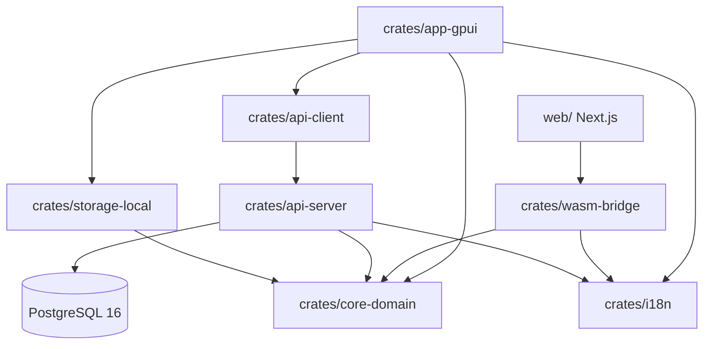

# Architecture Context — Umuryango Ledger

## 1. Monorepo Structure

```
umuryango-ledger/
├── AGENTS.md                   # Agent master instructions
├── .context/                   # System design, standards & progress tracking
├── Cargo.toml                  # Workspace manifest (resolver = "2")
├── locales/                    # Fluent bilingual catalog (en.ftl, rw.ftl)
├── migrations/                 # PostgreSQL migrations (SQLx with RLS)
├── assets/                     # Master branding and multi-platform icon assets
├── crates/
│   ├── i18n/                   # Bilingual translator & domain error catalog
│   ├── core-domain/            # Pure business logic, models, ledger math, reports
│   ├── storage-local/          # Offline SQLite cache & mutation sync queue
│   ├── api-client/             # Typed HTTP & WebSocket client for Rust apps
│   ├── api-server/             # Actix-web backend, SQLx PostgreSQL, auth, WS hub
│   ├── wasm-bridge/            # WebAssembly bindings for browser calculations
│   └── app-gpui/               # Desktop & mobile GPUI native application
└── web/                        # Next.js 15 App Router web application
    ├── public/                 # Static web assets, manifests, icons
    ├── src/
    │   ├── app/                # Root layout & bilingual routes (/[locale]/...)
    │   ├── components/         # Shared web UI components & charts
    │   └── lib/                # LedgerContext, API clients, WASM bridge loaders
    ├── tailwind.config.ts      # Brand palette design tokens
    └── package.json            # Web dependencies (Next.js, Tailwind, Lucide)
```

---

## 2. Layer Responsibilities & Dependencies



### `crates/core-domain` (Pure Domain Layer)
- Strictly zero network or database dependencies.
- Contains all mathematical assertions:
  - Total balance computation.
  - Dual-scope integrity (`PERSONAL` cannot reference family wallets; `FAMILY` requires family tenancy).
  - Custodian handovers (atomic source subtraction and target addition without changing total family net worth).
  - Validation of transaction allowances based on `FamilyRole` (`Head`, `Admin`, `Member`, `Elder`).

### `crates/i18n` (Bilingual Localization)
- Uses Mozilla Project Fluent (`fluent-bundle`).
- Reads `locales/en.ftl` and `locales/rw.ftl`.
- Provides static interpolation helper: `Translator::t(locale, key, args)`.
- Defines domain error translation catalog (`LocalizableError`, `LocalizedError`).

### `crates/storage-local` (Offline SQLite)
- Embeds SQLite via `rusqlite` bundled with UUID and chrono features.
- Maintains cache of `wallets`, `transactions`, `projects`, `loans`, and `sync_queue`.
- Stores `user_theme_prefs` for persistent light/dark and custom theme configuration.
- Guarantees idempotent offline mutation replay with unique `idempotency_key` UUIDs.

### `crates/api-server` (Backend Actix-web & PostgreSQL)
- Connection pooling with `sqlx::PgPool`.
- Password hashing using Argon2id (`argon2` crate).
- Stateless JWT authentication via `jsonwebtoken`.
- Real-time `FamilyHub`: `DashMap<Uuid, broadcast::Sender<RealtimeEvent>>` keyed by `family_id`.
- Zero-login magic link verification with cryptographic hash tokens.

---

## 3. PostgreSQL Security & Isolation
- All tables (`wallets`, `transactions`, `projects`, `loans`, `family_members`, `custody_handovers`) carry `tenant_id` (`family_id` or `user_id`).
- Row-Level Security (RLS) is enabled across all tables in production migrations.
- Personal transactions have `scope = 'PERSONAL'` and `user_id = auth_uid()`.
- Family transactions have `scope = 'FAMILY'` and check family membership via `family_members`.

---

## 4. Real-Time Broadcast Architecture
- WebSocket endpoint: `GET /api/v1/ws?token=<jwt>`.
- When a transaction or handover is committed in PostgreSQL, the server emits an event onto the family's broadcast channel.
- Connected clients (GPUI desktop/mobile and Next.js web) receive typed events:
  - `IncomeAdded`
  - `ExpenseLogged`
  - `HandoverCompleted`
  - `ProjectOrLoanUpdated`
- Clients immediately update local balances and display bilingual toast alerts.
